# Python Functions & Lists Assessment

## Project Overview

This repository contains two independent console-based Python programs that
demonstrate the use of **functions, string manipulation, lists, loops, and
input validation**.

The first program generates a result card for a single student. The second
program collects the marks of an entire class and produces a detailed
performance report. Both programs guide the user through the input process and
re-ask whenever invalid data is entered.

```text
python-functions-lists-assessment/
│
├── result_card_generator.py
├── class_marks_analyzer.py
├── README.md
├── package.json
│
├── diagrams/
│   ├── result_card_generator.mmd
│   ├── result_card_generator.svg
│   ├── result_card_generator.png
│   ├── class_marks_analyzer.mmd
│   ├── class_marks_analyzer.svg
│   ├── class_marks_analyzer.png
│   └── index.html
│
├── animations/
│   ├── index.html
│   ├── walkthrough.css
│   ├── walkthrough.js
│   └── data.js
│
└── scripts/
    ├── serve-diagrams.mjs
    └── serve-animations.mjs
```

---

## Program 1: Student Result Card Generator

**File:** `result_card_generator.py`

This program asks for a student's name, roll number, and marks in five
subjects: Mathematics, English, Physics, Chemistry, and Computer Science.

### Features

- Cleans the student's name with `.strip()` and `.title()`.
- Validates the roll number with `.isdigit()` so it can contain digits only.
- Validates every subject mark and only accepts whole numbers from 0 to 100.
- Calculates total marks and overall percentage.
- Calculates the letter grade from the overall percentage.
- Sets the final result to **Fail** if any subject mark is below 40. The letter
  grade is not changed by this rule.
- Displays a formatted result card using f-strings.

### Grading Criteria

| Percentage | Grade |
| --- | --- |
| 90 and above | A+ |
| 80 – 89 | A |
| 70 – 79 | B |
| 60 – 69 | C |
| 50 – 59 | D |
| Below 50 | Fail |

### Required Functions

| Function | Purpose |
| --- | --- |
| `format_name(name)` | Cleans the name with `.strip()` and `.title()`. |
| `get_valid_marks(subject)` | Reads and validates marks between 0 and 100. |
| `calculate_percentage(total, max_total)` | Calculates the overall percentage. |
| `get_grade(percentage)` | Returns the letter grade for a percentage. |
| `main()` | Collects the inputs, applies the final result rule, and prints the card. |

---

## Program 2: Class Marks Analyzer

**File:** `class_marks_analyzer.py`

This program asks for the number of students in a class, then collects each
student's name and marks. Names and marks are stored in two parallel lists:
`student_names` and `student_marks`.

### Features

- Validates the class size and every student mark.
- Uses `.append()` to add names and marks to their lists.
- Calculates the class average.
- Finds the highest and lowest marks and every student who achieved them.
- Counts passing students (50 or above) and failing students (below 50).
- Lists all students who scored above the class average.
- Displays all students sorted by marks from highest to lowest.
- Handles tied highest and lowest marks by displaying every matching student.

### Custom Functions

| Function | Purpose |
| --- | --- |
| `get_valid_mark(student_name)` | Reads and validates a mark from 0 to 100. |
| `display_report(names, marks)` | Calculates the statistics and prints the class report. |
| `main()` | Collects the class size, names, and marks into two parallel lists. |

---

## Architecture Diagrams

The `diagrams/` folder contains editable Mermaid sources and rendered diagrams
for both programs. Each diagram maps the entry point, validation loops,
calculation steps, function inputs and return values, and the final output.

### Result Card Generator

[](diagrams/result_card_generator.svg)

### Class Marks Analyzer

[](diagrams/class_marks_analyzer.svg)

Mermaid is installed locally in this repository, so the diagrams do not depend
on a CDN or an internet connection.

```bash
npm install          # install Mermaid and the diagram tools
npm run diagrams     # regenerate SVG and PNG files from the .mmd sources
npm run diagrams:preview
```

`npm run diagrams:preview` starts a local web server at
`http://localhost:8080/diagrams/`, where both diagrams are rendered in the
browser using the Mermaid JavaScript API.

---

## Interactive Code Walkthrough

The `animations/` folder contains a browser-based, step-by-step animation of
both programs. It uses only plain HTML, CSS, and JavaScript - no animation
library and no runtime dependency.

Open `animations/index.html` directly in a browser, or start the preview server:

```bash
npm run animations:preview
```

Then visit `http://localhost:8081/animations/`.

For every step, the walkthrough shows:

- the exact source lines being executed, highlighted in the code panel;
- the focused function, its signature, and its docstring;
- the call stack as functions are entered and exited;
- the variables that change, with new and updated values marked;
- the simulated terminal input and output.

Use the Prev / Next buttons, the scrubber, or the keyboard shortcuts
(<kbd>Space</kbd> = play/pause, <kbd>Left</kbd>/<kbd>Right</kbd> = step,
<kbd>R</kbd> = restart). The speed selector controls autoplay. The scenario used
by the animation is listed above the panels so the values on screen can be
checked against a real run.

---

## Python Concepts Used

- Defining functions with `def`, parameters, and `return` values.
- String methods: `.strip()`, `.title()`, `.isdigit()`.
- Formatted output with f-strings and alignment/format specifiers.
- `if` / `elif` / `else` conditions and comparison operators.
- `while` loops for repeated input validation.
- `for` loops for collecting subjects and displaying lists.
- Lists: creating lists, `.append()`, `len()`, `sum()`, `max()`, `min()`, and `sorted()`.
- Exception handling with `try` / `except` for clean program cancellation.
- Parallel lists, `zip()`, `enumerate()`, and `lambda` for sorting.

---

## Requirements

- Python 3.8 or newer.
- Python programs: no external libraries are required.
- Walkthrough: any modern browser; no extra libraries are required.
- Diagram tooling: Node.js 20 or newer and npm.

Check the installed versions with:

```bash
python --version
node --version
npm --version
```

---

## How to Run

Open a terminal in the repository folder and run either program:

### Student Result Card Generator

```bash
python result_card_generator.py
```

### Class Marks Analyzer

```bash
python class_marks_analyzer.py
```

On systems where `python` is not available, try `python3` instead.

---

## Sample Input and Output

### Sample 1: Result Card Generator

**Input:**

```text
Enter student name:   aYESHA khan
Enter roll number: 12345
Enter marks for Mathematics (0-100): 95
Enter marks for English (0-100): 88
Enter marks for Physics (0-100): 92
Enter marks for Chemistry (0-100): 90
Enter marks for Computer Science (0-100): 85
```

**Output:**

```text
===== Student Result Card Generator =====
Enter student name: Enter roll number: Enter marks for Mathematics (0-100): Enter marks for English (0-100): Enter marks for Physics (0-100): Enter marks for Chemistry (0-100): Enter marks for Computer Science (0-100):

==================================================
               STUDENT RESULT CARD
==================================================
Student Name : Ayesha Khan
Roll Number  : 12345
--------------------------------------------------
Subject                       Marks
--------------------------------------------------
Mathematics                      95
English                          88
Physics                          92
Chemistry                        90
Computer Science                 85
--------------------------------------------------
Total Marks  : 450/500
Percentage   : 90.00%
Grade        : A+
Result       : Pass
==================================================
```

### Sample 2: Subject Below 40 Forces a Fail

This student has an overall percentage of 80.00%, but Chemistry is below 40, so
the final result is Fail. The letter grade remains the grade for the overall
percentage.

**Input:**

```text
Enter student name: Hassan Ali
Enter roll number: 21
Enter marks for Mathematics (0-100): 95
Enter marks for English (0-100): 92
Enter marks for Physics (0-100): 88
Enter marks for Chemistry (0-100): 35
Enter marks for Computer Science (0-100): 90
```

**Output:**

```text
--------------------------------------------------
Total Marks  : 400/500
Percentage   : 80.00%
Grade        : A
Result       : Fail
Failed Subject(s): Chemistry
==================================================
```

### Sample 3: Class Marks Analyzer

**Input:**

```text
How many students are in the class? 4
Enter name of student 1: ali
Enter marks for Ali (0-100): 90
Enter name of student 2: Sara
Enter marks for Sara (0-100): 75
Enter name of student 3: Bob
Enter marks for Bob (0-100): 90
Enter name of student 4: Cara
Enter marks for Cara (0-100): 40
```

**Output:**

```text
=======================================================
              CLASS MARKS ANALYZER REPORT
=======================================================
Total students     : 4
Class average      : 73.75
Highest marks      : 90
Highest scorer(s)  : Ali, Bob
Lowest marks       : 40
Lowest scorer(s)   : Cara
Passing students   : 3
Failing students   : 1
-------------------------------------------------------
Students who scored above the class average:
  - Ali: 90
  - Sara: 75
  - Bob: 90
-------------------------------------------------------
Students sorted by marks (highest to lowest):
  1. Ali                        90
  2. Bob                        90
  3. Sara                       75
  4. Cara                       40
=======================================================
```

---

## Validation and Test Scenarios

Both programs were tested with normal, boundary, and invalid inputs:

| Scenario | Expected Behaviour | Result |
| --- | --- | --- |
| Name with extra spaces and mixed case | Cleaned to `Ayesha Khan` | Passed |
| Empty student name | Re-asks for input | Passed |
| Roll number containing letters (`12a`) | Re-asks for input | Passed |
| Non-numeric marks (`abc`) | Re-asks for input | Passed |
| Marks below 0 or above 100 | Re-asks for input | Passed |
| Decimal marks (for example `49.5`) | Rejected because marks must be whole numbers | Passed |
| One subject below 40 but high percentage | Result is Fail, letter grade follows percentage | Passed |
| Percentage exactly 50 | Grade D and Pass | Passed |
| Percentage exactly 90 | Grade A+ | Passed |
| Tied highest and lowest marks | All matching students displayed | Passed |
| Invalid class size (`0`, `abc`) | Re-asks for input | Passed |
| Students equal to the class average | Not listed as above average | Passed |
